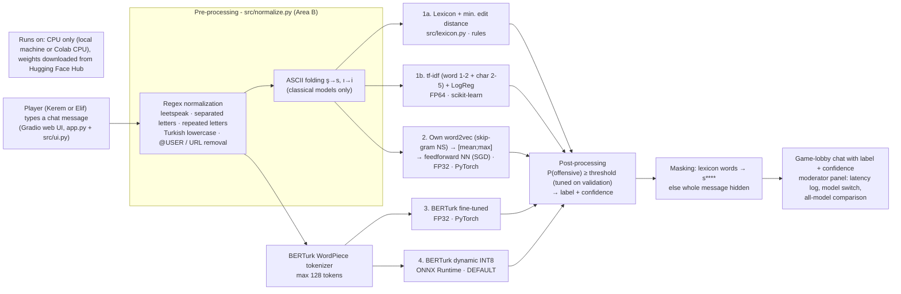

# Architecture

**Training (offline, Google Colab T4 GPU):**
`prepare_data.py` → `train_baselines.py` → `train_w2v_ffn.py` → `train_bert.py` → `quantize_bert.py` → `benchmark.py` (CPU) → `upload_models.py`.

| Component | File | Technique area |
|---|---|---|
| Regex normalization, ASCII folding | `src/normalize.py` | B |
| Lexicon matcher, Levenshtein distance | `src/lexicon.py`, `data/lexicon_tr.txt` | B |
| tf-idf + logistic regression | `scripts/train_baselines.py` | B |
| Own word2vec (skip-gram, negative sampling) | `src/w2v_ffn.py` | B (embeddings), A |
| Feedforward network, SGD + backprop, dropout | `src/w2v_ffn.py`, `scripts/train_w2v_ffn.py` | A |
| BERTurk fine-tuning, WordPiece tokenizer | `scripts/train_bert.py` | C |
| ONNX export + dynamic INT8 quantization | `scripts/quantize_bert.py` | D |
| Benchmark: macro-F1, size, latency | `scripts/benchmark.py` | D |
| Common inference interface | `src/predictors.py` | - |
| User interface | `app.py`, `src/ui.py` | - |
